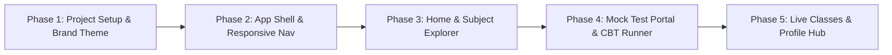

# Tutopia Exam (tutopiaxm) — Web App Architecture & UX Blueprint

> **Target Platform:** Next.js 15 (App Router) + React 19 + TypeScript + Tailwind CSS + shadcn/ui  
> **Source Reference:** Android App v1.0 (Home, Mock Tests, Video Classes, Subject Hierarchy, Live Classes, More, My Profile)  
> **Design Philosophy:** Faithful preservation of Tutopia's signature Blue & Gold brand identity, enhanced with responsive Desktop + Tablet + Mobile web UX patterns.

---

## 1. Visual Brand Identity & Design System

Based on the 7 mobile app screens, the Tutopia brand uses a recognizable primary blue paired with energetic amber/yellow accents, high-contrast typography, and clean bordered cards.

### 1.1 Color Tokens & Palette

| Token Name | Hex Code | Tailwind / HSL | Usage in App |
| :--- | :--- | :--- | :--- |
| **Brand Primary (Blue)** | `#0284C7` / `#0072BC` | `hsl(204, 100%, 37%)` | Primary buttons ("Buy now", "Edit Profile", "Chapter wise MCQ"), active navigation tab, primary icon accents. |
| **Brand Secondary (Yellow/Amber)** | `#F59E0B` / `#FBBF24` | `hsl(43, 96%, 52%)` | CTA buttons ("Subscriptions", "Explore" border), promo banner highlights, secondary card bottom accents. |
| **Soft Blue Tint (Light)** | `#E0F2FE` / `#BAE6FD` | `hsl(204, 94%, 94%)` | "Competitive Exam" banner background, badge backgrounds, search bar active outlines. |
| **Neutral Background** | `#F8FAFC` | `hsl(210, 40%, 98%)` | Global page background (soft slate/grey matching mobile app background). |
| **Card / Surface** | `#FFFFFF` | `hsl(0, 0%, 100%)` | Elevated content cards, search input surface, modal backgrounds. |
| **Text Primary** | `#0F172A` | `hsl(222, 47%, 11%)` | Headings, user name ("Abhilash Bera"), exam titles, subject labels. |
| **Text Secondary / Muted** | `#64748B` | `hsl(215, 16%, 47%)` | Subtitles ("0 chapter", "Last attempted: 27-09-2030", "Duration 03:00 Hrs"). |
| **Card Borders / Dividers** | `#E2E8F0` | `hsl(214, 32%, 91%)` | Card borders, dashed lines in live class cards, menu item separators. |

### 1.2 Signature Tutopia Visual Motifs
1. **Dual Accent Card Stripes**: Grid cards feature a 3px rounded bottom accent strip in either Tutopia Blue (`border-b-4 border-sky-600`) or Tutopia Yellow (`border-b-4 border-amber-400`).
2. **Promotional Hero Carousel**: Supports regional script banner artwork (Bengali & English), with centered pill dot paginators.
3. **Pill Action Bars**: Rounded rectangular quick-action buttons with left icon and right chevron indicator.
4. **Clean Line Icons**: Dual-tone flat/line illustrations for exam categories (books, gears, charts, bank facade, lightbulbs).

---

## 2. Gemini-Optimized Folder Architecture

### Why a "Gemini-Specific" Architecture?
When building with Gemini / Antigravity pair programming, folder structure should maximize:
1. **Context Locality**: Feature code (components, hooks, actions, types) stays within its own feature module so subagents can read and edit without loading extraneous context.
2. **Predictable File Naming**: Explicit filenames (`course-card.tsx`, `use-mock-tests.ts`) avoid ambiguous `index.tsx` confusion across multiple tabs.
3. **Clean Boundary between Server & Client**: Clear division between data-fetching Server Components (`page.tsx`) and interactive Client Components (`*-client.tsx`).

### Project Directory Tree

```
tutopiaxm/
├── refrence/                         # Original Mobile App Screenshots (1.png - 7.png)
├── public/
│   ├── images/
│   │   ├── banners/                  # Promotional banners (e.g., ₹1999 1-yr prep)
│   │   ├── categories/               # Vector/SVG icons (SSC, Banking, WBCS, etc.)
│   │   └── avatars/                  # Default user avatars
│   └── fonts/                        # Hind Siliguri / Noto Sans Bengali font files
├── src/
│   ├── app/                          # Next.js 15 App Router
│   │   ├── layout.tsx                # Root layout (Theme, Fonts, Providers)
│   │   ├── globals.css               # Tailwind CSS & Design System Variables
│   │   ├── not-found.tsx             # Branded 404
│   │   ├── error.tsx                 # Error boundary
│   │   │
│   │   ├── (auth)/                   # Authentication route group
│   │   │   ├── layout.tsx            # Clean centered auth layout
│   │   │   ├── login/page.tsx        # Mobile OTP / Password Login
│   │   │   └── register/page.tsx     # Student Registration
│   │   │
│   │   ├── (dashboard)/              # Main App Shell (with Header, Sidebar & Mobile Nav)
│   │   │   ├── layout.tsx            # Responsive app shell (Desktop sidebar + Mobile bottom bar)
│   │   │   ├── page.tsx              # Home / Dashboard (Screen 1 & 3)
│   │   │   │
│   │   │   ├── mock-tests/           # Mock Test Hub (Screen 2)
│   │   │   │   ├── page.tsx          # Mock test listing
│   │   │   │   ├── history/page.tsx  # Past test attempts & scorecards
│   │   │   │   └── [testId]/
│   │   │   │       ├── page.tsx      # Test details & syllabus
│   │   │   │       └── take/page.tsx # Fullscreen CBT (Computer Based Test) Runner
│   │   │   │
│   │   │   ├── subjects/             # Video Classes & Subject Explorer (Screen 3 & 4)
│   │   │   │   ├── page.tsx          # All Subject Categories
│   │   │   │   └── [examCategory]/   # e.g., /subjects/ssc-rail-wbcs
│   │   │   │       ├── page.tsx      # Subject & Chapter Grid (Maths, English, GK, etc.)
│   │   │   │       └── [subjectSlug]/# e.g., /subjects/ssc-rail-wbcs/mathematics
│   │   │   │           └── page.tsx  # Chapter list & video player
│   │   │   │
│   │   │   ├── live-classes/         # Live Classes Hub (Screen 5)
│   │   │   │   ├── page.tsx          # Live schedules & enrolled batches
│   │   │   │   └── [batchId]/
│   │   │   │       ├── page.tsx      # Batch details & curriculum
│   │   │   │       └── watch/page.tsx# Interactive live classroom player with chat
│   │   │   │
│   │   │   ├── chapter-mcq/          # Chapter-wise MCQ Practice
│   │   │   │   ├── page.tsx          # MCQ Subject Selector
│   │   │   │   └── [chapterId]/page.tsx # Interactive Practice Quiz
│   │   │   │
│   │   │   ├── profile/              # User Profile & Account (Screen 7)
│   │   │   │   ├── page.tsx          # View Profile & Details
│   │   │   │   ├── edit/page.tsx     # Edit Profile Form
│   │   │   │   ├── subscriptions/page.tsx # Active plans & invoices
│   │   │   │   └── change-password/page.tsx
│   │   │   │
│   │   │   └── more/                 # More / Support / Settings (Screen 6)
│   │   │       ├── page.tsx          # Settings list (for mobile parity)
│   │   │       ├── report-issue/page.tsx
│   │   │       └── terms/page.tsx
│   │   │
│   │   └── api/                      # Next.js API route handlers
│   │       ├── auth/[...nextauth]/route.ts
│   │       ├── mock-tests/route.ts
│   │       └── live-classes/route.ts
│   │
│   ├── components/                   # Shared UI Components
│   │   ├── ui/                       # shadcn/ui primitives
│   │   │   ├── button.tsx
│   │   │   ├── card.tsx
│   │   │   ├── dialog.tsx
│   │   │   ├── dropdown-menu.tsx
│   │   │   ├── input.tsx
│   │   │   ├── badge.tsx
│   │   │   ├── tabs.tsx
│   │   │   ├── sheet.tsx
│   │   │   ├── carousel.tsx
│   │   │   ├── progress.tsx
│   │   │   ├── avatar.tsx
│   │   │   └── separator.tsx
│   │   │
│   │   ├── layout/                   # Structural layout components
│   │   │   ├── app-header.tsx        # Top navigation with avatar, name, search, bell
│   │   │   ├── app-sidebar.tsx       # Desktop collapsible navigation
│   │   │   ├── mobile-bottom-bar.tsx # Exact 3-tab mobile navigation (Home, Live, More)
│   │   │   └── search-command-dialog.tsx # Quick CMD+K search dialog
│   │   │
│   │   └── common/                   # Reusable domain-neutral components
│   │       ├── banner-carousel.tsx   # Swiper/Carousel for promo banners
│   │       ├── category-card.tsx     # Tutopia dual-accent styled card
│   │       ├── exam-pill-button.tsx  # Quick action pill button with chevron
│   │       └── empty-state.tsx
│   │
│   ├── features/                     # Domain-Driven Feature Modules
│   │   ├── home/
│   │   │   ├── components/
│   │   │   │   ├── promo-banner-slider.tsx
│   │   │   │   ├── quick-access-pills.tsx
│   │   │   │   └── video-class-categories-grid.tsx
│   │   │   └── services/
│   │   │
│   │   ├── mock-tests/
│   │   │   ├── components/
│   │   │   │   ├── mock-test-card.tsx
│   │   │   │   ├── mock-test-filter-bar.tsx
│   │   │   │   ├── mock-test-timer.tsx
│   │   │   │   └── question-palette.tsx
│   │   │   ├── hooks/
│   │   │   │   └── use-cbt-runner.ts
│   │   │   └── types/
│   │   │       └── mock-test.ts
│   │   │
│   │   ├── subjects/
│   │   │   ├── components/
│   │   │   │   ├── subject-header-filter.tsx
│   │   │   │   ├── chapter-accordion.tsx
│   │   │   │   └── topic-grid.tsx
│   │   │   └── types/
│   │   │       └── subject.ts
│   │   │
│   │   ├── live-classes/
│   │   │   ├── components/
│   │   │   │   ├── live-batch-card.tsx
│   │   │   │   ├── live-stream-embed.tsx
│   │   │   │   └── live-chat-panel.tsx
│   │   │   └── types/
│   │   │
│   │   └── profile/
│   │       ├── components/
│   │       │   ├── profile-detail-card.tsx
│   │       │   ├── edit-profile-dialog.tsx
│   │       │   └── subscription-card.tsx
│   │       └── types/
│   │
│   ├── lib/                          # Utility functions & Singletons
│   │   ├── utils.ts                  # cn() classnames merger
│   │   ├── constants.ts              # App metadata, links, exam categories
│   │   ├── mock-data.ts              # High-fidelity mock dataset matching app screens
│   │   └── api-client.ts             # Fetcher client with auth interceptors
│   │
│   └── types/                        # Global TypeScript interfaces
│       └── global.d.ts
```

---

## 3. Screen-by-Screen UX Translation (Mobile App -> Web App)

```mermaid
flowchart TD
    User([Student on Web App]) --> TopNav[Top Navbar: User Profile | Search CMD+K | Notifications]
    TopNav --> MainContent{Route / Viewport}

    subgraph "Desktop Layout (>= 1024px)"
        SideNav[Collapsible Sidebar: Home | Live Classes | Mock Tests | Subjects | Profile]
        MainGrid[Main Content: Multi-column Card Grid, Analytics & Split View]
    end

    subgraph "Mobile Viewport (< 1024px)"
        ScreenView[Single Column Vertical Scroll]
        BottomNav[Fixed Bottom Nav: Home | Live Classes | More]
    end

    MainContent --> SideNav
    MainContent --> MainGrid
    MainContent --> ScreenView
    MainContent --> BottomNav
```

### Screen 1: Home Dashboard (`refrence/1.png` & `3.png`)
* **Mobile App:**
  - Header: Avatar circle + "Abhilash Bera", Notification Bell, Search icon.
  - Promo carousel: 1-Year Prep Banner with dots.
  - Quick action buttons: "Chapter wise MCQ" & "Competitive Exam".
  - "Video Classes" section with 2x2 grid cards with bottom accent border.
* **Web App Translation & UX Enhancements:**
  - **Desktop Header:** Fixed sticky bar with Tutopia Exam logo, exam switcher dropdown (`SSC`, `WBCS`, `Rail`), global search input with shortcut hint (`Ctrl + K`), notification badge with dropdown popover, and profile menu.
  - **Banner Carousel:** Wide aspect-ratio banner with auto-slide, pause on hover, and smooth keyboard/swipe gestures.
  - **Quick Action Bar:** Converted into prominent hero action tiles with hover scaling and elevation.
  - **Video Classes Grid:** Responsive grid (`grid-cols-2 sm:grid-cols-3 lg:grid-cols-4 xl:grid-cols-5`). Each card preserves the signature blue or gold bottom accent bar with subtle shine effect on hover.

---

### Screen 2: Mock Tests (`refrence/2.png`)
* **Mobile App:**
  - Cards listing exam name, 100 Marks, Duration 03:00 Hrs, Last attempted date, action button, and "View History" link.
  - Fixed bottom bar: "View Mock test history".
* **Web App Translation & UX Enhancements:**
  - **Filter & Search Bar:** Filter tests by Status (*All*, *Not Attempted*, *In Progress*, *Completed*), Subject (*Mathematics*, *Reasoning*, *English*, *GK*), and difficulty.
  - **Rich Test Card:** Shows progress meter (% score if previously attempted), badge indicators for *Live Test*, *Full Length Mock*, or *Sectional Test*.
  - **Full-Screen CBT Mode (`/mock-tests/[testId]/take`):**
    - High-stakes test runner interface modeled after official TCS iON / SSC exams.
    - Question palette on right sidebar (Color coded: Answered, Not Answered, Marked for Review).
    - Top sticky countdown timer with audio warning when under 5 minutes.
    - Full-screen lock and auto-submit safeguard.

---

### Screen 3 & 4: Subject Explorer (`refrence/3.png` & `4.png`)
* **Mobile App:**
  - Header with exam badge dropdown selector (e.g., `SSC, RAIL, WBCS` -> dropdown `SSC`).
  - Search subject bar.
  - Categorized subjects in grid groups: Mathematics, Reasoning, English, General Knowledge, Static GK.
  - Sub-cards show topic name + chapter count badge (e.g. `Arithmetic - 1 chapter`, `English Grammar - 12 chapters`).
* **Web App Translation & UX Enhancements:**
  - **Sticky Breadcrumb & Exam Switcher:** Allows seamless switching between exam tracks (SSC CGL vs WBCS Prelims vs Bank PO).
  - **Live Search Filter:** Real-time client-side instant filter highlighting matching chapters as the user types in the search bar.
  - **Interactive Chapter Drawer / Detail View:** Clicking any topic (e.g. "Arithmetic") slides out a drawer or navigates to dedicated video lectures + study notes + practice quizzes for that chapter.

---

### Screen 5: Live Classes (`refrence/5.png`)
* **Mobile App:**
  - Header "Live Classes" with carousel preview.
  - Batch cards with course thumbnail banner, schedule dates ("Starts on 30th Sept 2026 - Ends on 15th Sept 2027"), pricing model ("Yearly Subscription Model"), and action buttons: "Explore" (Yellow border) & "Buy now" (Blue fill).
* **Web App Translation & UX Enhancements:**
  - **Live Stream Schedule Calendar:** Toggle between "List View" and "Weekly Schedule Grid" so students see today's upcoming live classes.
  - **Active Batch Badging:** "Live Now" pulsating badge with quick "Join Class" button.
  - **Web Classroom View (`/live-classes/[batchId]/watch`):** Split layout featuring the primary video stream (HLS / YouTube Live embed) on the left, and real-time interactive Q&A / doubt chat panel on the right.

---

### Screen 6: More / Support (`refrence/6.png`)
* **Mobile App:**
  - Menu list: My profile, Report an issue, Terms & conditions, Logout button, version footer.
* **Web App Translation & UX Enhancements:**
  - On mobile screens: Retained as the familiar 3rd tab in the bottom bar.
  - On desktop: Integrated into the user avatar dropdown menu in the top navbar and dedicated Settings sidebar.
  - Added "Report an issue" interactive modal with screenshot upload and issue categorization.

---

### Screen 7: My Profile (`refrence/7.png`)
* **Mobile App:**
  - User avatar, Name ("Abhilash Bera"), Mobile, WhatsApp number, City, Pincode ("700006"), Address.
  - Action buttons: Full-width Yellow "Subscriptions", Blue "Edit Profile", Outlined "Change Password".
* **Web App Translation & UX Enhancements:**
  - Two-column responsive profile layout:
    - Left column: Profile summary card, subscription tier badge (e.g., "Annual All-Access Pass - Active"), quick action buttons.
    - Right column: Tabbed settings panel: *Personal Details*, *Active Subscriptions & Invoices*, *Security / Change Password*, *Notification Preferences*.

---

## 4. shadcn/ui & Radix Component Specification

The following standard shadcn/ui components will be installed and styled with Tutopia brand tokens:

| shadcn Component | Specific Use in Tutopia Web | Custom Styling / Variant |
| :--- | :--- | :--- |
| `Button` | Primary action buttons ("Buy now", "Explore", "Subscriptions") | Variants: `variant="tutopia-primary"` (solid blue), `variant="tutopia-accent"` (solid yellow), `variant="tutopia-outline"` |
| `Card` | Category cards, Mock test items, Live batch containers | Custom class `border-slate-100 shadow-sm hover:shadow-md transition-all` + bottom colored accent strip |
| `Badge` | Chapter counts ("12 chapters"), Marks ("100 Marks") | `bg-sky-50 text-sky-700 border-sky-200` |
| `Dialog` / `Sheet` | "Edit Profile", "Report an Issue", Mobile navigation drawer | Accessible focus management, smooth slide-in |
| `Carousel` (Embla) | Promotional banners (`1.png`), Live class previews (`5.png`) | Custom pill pagination dots matching mobile app |
| `DropdownMenu` | Exam switcher (`SSC, RAIL, WBCS` selector in `4.png`) | Clean list with checkmark for active exam |
| `Command` | Global search dialog triggered by `Cmd + K` or search icon | Instant subject/chapter/test search |
| `Tabs` | Mock test tabs (*Upcoming*, *Attempted*, *Analytics*) | Underline style with Tutopia primary blue indicator |
| `Avatar` | Student avatar in header and profile screen | Initial fallback (`AB`) or uploaded photo |

---

## 5. Mock Data Architecture (`src/lib/mock-data.ts`)

To allow rapid development and immediate preview of all screens without waiting for backend APIs, a structured mock dataset is modeled directly from the reference screenshots:

```typescript
// Sample Data Model for Categories & Subjects matching 1.png & 4.png
export interface ExamCategory {
  id: string;
  name: string; // e.g. "SSC, RAIL, WBCS"
  slug: string;
  subCategory: string; // "SSC"
  accentColor: "blue" | "yellow";
  iconName: string;
}

export interface SubjectSection {
  id: string;
  name: string; // "Mathematics", "Reasoning", "English", "General Knowledge"
  topics: {
    id: string;
    title: string; // "Arithmetic", "Algebra", "Englisg Grammer"
    chapterCount: number;
    completedCount: number;
  }[];
}

export interface MockTestItem {
  id: string;
  title: string;
  totalMarks: number;
  durationMinutes: number;
  lastAttemptedDate?: string;
  status: "not_started" | "in_progress" | "completed";
}

export interface LiveBatch {
  id: string;
  title: string; // "SSC RAIL WBCS PSC Batch"
  bannerImage: string;
  startDate: string; // "30th September, 2026"
  endDate: string; // "15th September, 2027"
  pricingType: "Yearly Subscription Model";
  price: number;
  discountedPrice: number;
  isEnrolled: boolean;
}
```

---

## 6. Implementation Milestones



1. **Phase 1: Project Foundation & Design System Setup**
   - Initialize Next.js 15 App Router with Tailwind CSS and TypeScript.
   - Configure `@/` path aliases, Tutopia colors in `globals.css` and `tailwind.config.ts`.
   - Install Lucide icons and base shadcn/ui components.

2. **Phase 2: Responsive App Shell & Navigation**
   - Implement `AppHeader` (Desktop avatar, search bar, notifications).
   - Implement `MobileBottomBar` (recreating the exact 3-tab bottom bar: Home, Live Classes, More).
   - Implement `AppSidebar` for wide screens.

3. **Phase 3: Dashboard & Subject / Chapter Explorer**
   - Build promotional banner carousel with dot paginator (`1.png`).
   - Implement quick action pill buttons ("Chapter wise MCQ", "Competitive Exam").
   - Implement 2-column / multi-column video classes category grid (`3.png`).
   - Build subject breakdown screen with categorized sections (`4.png`).

4. **Phase 4: Mock Test Hub & Test Runner**
   - Implement Mock Test card list with duration, marks, and history links (`2.png`).
   - Build Mock Test History view and Computer Based Test (CBT) quiz interface.

5. **Phase 5: Live Classes, Profile & Account Settings**
   - Build Live Batch card with action buttons ("Explore", "Buy now") (`5.png`).
   - Build My Profile screen with edit profile modal and subscription details (`7.png`).
   - Build More screen (`6.png`) with Report Issue and Terms views.
